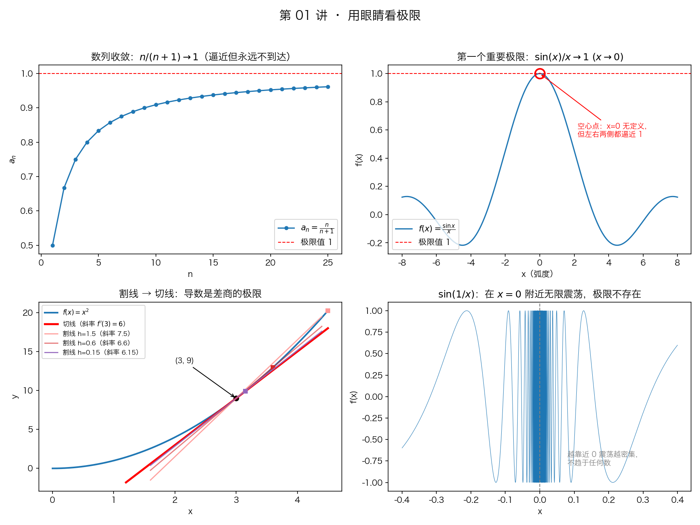
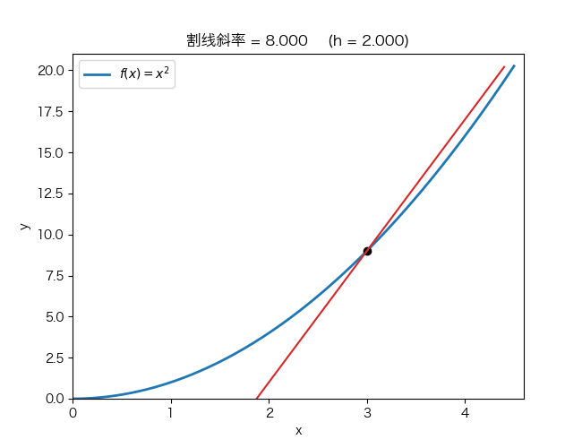

# 第 01 讲：极限的直觉——微积分的第一块基石

> 学习时间：约 60 分钟。学完请做文末的练习，并运行 `tools/verify_limit.py`。

[学习首页](../README.md) · [下一讲：运算法则与无穷小](第02讲-极限的运算法则与无穷小的比较.md)

## 1. 为什么从极限开始？

整个微积分建立在两个问题之上：

1. **瞬时速度是多少？**（比如踩油门瞬间，速度表的读数怎么定义？）→ 导数
2. **曲线围成的面积是多少？**（比如不规则水池的蓄水量）→ 积分

这两个问题的共同难点：它们都涉及**"无限分割、无限逼近"**的过程。而描述"无限逼近"的数学语言，就是**极限（limit）**。

## 2. 极限在说什么？一个直觉版本

以数列为例：

$$\frac{1}{2},\ \frac{2}{3},\ \frac{3}{4},\ \frac{4}{5},\ \ldots,\ \frac{n}{n+1},\ \ldots$$

每一项都小于 1，但随着 $n$ 增大，这些数**无限逼近 1**。我们说：

$$\lim_{n \to \infty} \frac{n}{n+1} = 1$$

**关键理解（很多初学者搞错的地方）**：

- 极限描述的是**趋势**，不要求"到达"。数列永远不会等于 1，但它的极限是 1。
- 换成程序员的语感：极限就像**收敛的迭代过程**——`while True: x = f(x)`，循环永远不真正"结束"，但输出越来越稳定，那个稳定值就是极限。

## 3. 一个挑战直觉的例子：0.999... = 1 吗？

$$0.9,\ 0.99,\ 0.999,\ 0.9999,\ \ldots$$

这个数列的每一项都小于 1，但极限是 1。而 $0.999\ldots$（无限个 9）按定义就是这个数列的极限，所以：

$$0.999\ldots = 1$$

注意：不是约等于，是严格相等。

如果你觉得别扭，恭喜你——这说明你在认真思考。这正是"极限是趋势"的最好注脚：无限个 9 的写法，指的就是那个被无限逼近的值本身。

## 4. 函数极限：x 逼近某点时 f(x) 去哪？

对函数 $f(x) = \frac{x^2-1}{x-1}$：

- $x = 1$ 时分母为 0，函数**没定义**；
- 但 $x = 0.9$ 时 $f = 1.9$， $x = 0.99$ 时 $f = 1.99$， $x = 1.01$ 时 $f = 2.01\ldots$

$x$ 从两边逼近 1 时， $f(x)$ 逼近 2。所以：

$$\lim_{x \to 1} \frac{x^2-1}{x-1} = 2$$

（因为 $x \ne 1$ 时约分得 $f(x) = x+1$，代入即得。）

**注意**：极限只关心" $x$ 逼近时的行为"， $x$ 能不能取到那个点根本不重要。这在编程里也有对应：函数在一点"崩溃"（除零），但它在该点邻域的趋势仍然良好。

## 5. 第一个重要极限：sin x / x 在 x → 0 时趋于 1

这是高数出镜率最高的极限之一，后面推导导数公式会用到：

$$\lim_{x \to 0} \frac{\sin x}{x} = 1$$

直觉： $x$ 很小时（弧度制），弧长 $x$ 和正弦值 $\sin x$ 几乎重合。几何上在单位圆里画个图非常直观（B站搜"两个重要极限 几何"）。

记住三个常用推论：

$$\lim_{x \to 0} \frac{\sin x}{x} = 1, \qquad \lim_{x \to 0} \frac{\tan x}{x} = 1, \qquad \lim_{x \to 0} \frac{1-\cos x}{x^2} = \frac{1}{2}$$

### 用图回顾：极限是趋势，不要求点上有值



按左上 → 右上 → 左下 → 右下看：数列逼近 1；函数在 0 处没有定义却有极限；割线逐渐贴近切线；振荡函数则没有稳定的极限。空心点表示该位置没有函数值，虚线表示参考极限，不是新增的函数分支。

## 6. 严格的 ε-δ 定义（现在只需"见过"，不用掌握）

教科书上会写：

$$\forall \varepsilon > 0,\ \exists \delta > 0:\quad 0 < |x - x_0| < \delta \implies |f(x) - A| < \varepsilon$$

翻译成人话：**你说一个任意小的误差容忍度 $\varepsilon$，我总能找到一个足够小的逼近范围 $\delta$，保证 $f(x)$ 和 $A$ 的距离小于 $\varepsilon$。**

这就是数学家把"无限逼近"严格化的方式。现阶段你只需要有直觉版本， $\varepsilon$- $\delta$ 在做题中慢慢内化即可，别在这里卡壳。

## 7. 课后练习（先自己做，再对答案）

**练习 1**：观察数列 $1,\ \frac{1}{2},\ \frac{1}{4},\ \frac{1}{8},\ \ldots$，它的极限是多少？

**练习 2**：求

$$\lim_{x \to 2} \frac{x^2-4}{x-2}$$

（提示：先因式分解，约分后代入。）

**练习 3**：求

$$\lim_{x \to 0} \frac{\sin 3x}{x}$$

（提示： $\frac{\sin 3x}{x} = 3 \cdot \frac{\sin 3x}{3x}$，套第一个重要极限。）

**练习 4**（思考题，不看资料）：函数 $f(x)$ 在 $x = 0$ 处没有定义，能否有 $\lim\limits_{x \to 0} f(x)$？反过来， $f(0)$ 存在，能否保证极限存在？

---

### 答案

1. 极限是 0：每项是 $\frac{1}{2^n}$，指数增长地"缩"，趋于 0。
2. 因式分解 $\frac{(x-2)(x+2)}{x-2} = x+2$，代入 $x = 2$ 得 **4**。
3. $3 \cdot \frac{\sin 3x}{3x} \to 3 \cdot 1 =$ **3**。
4. 前半：**能**！极限不要求该点有定义（见本讲第 4 节的例子）。后半：**不能**—— $f(0)$ 的值和 $x \to 0$ 的趋势可以毫无关系（比如 $f(x)$ 在 0 附近来回跳）。

---

## 8. 动手环节

两个脚本，建议都跑：

```bash
python3 tools/verify_limit.py       # 文字版：看数字一步步逼近
python3 tools/visualize_limit.py    # 图形版：弹出四张可视化图
```

图形版会把本讲的四个结论画在一张图里（同时保存为 `assets/images/lecture01/limit_plots.png`）：

1. 数列 $\frac{n}{n+1}$ 的点如何贴着 $y = 1$ 这条虚线走
2. $\frac{\sin x}{x}$ 的曲线在 $x = 0$ 处的"空心点"（无定义，但两侧都逼近 1）
3. 三条割线如何越来越贴近切线（导数的几何意义预告）
4. $\sin\frac{1}{x}$ 在 0 附近越来越密集的震荡（极限不存在的样子）

还有一个进阶玩法：

```bash
python3 tools/animate_calculus.py   # 动画版：预演微积分后面三大主角
```

它会在 `assets/animations/` 生成三个 GIF 动画：**割线如何转成切线**（导数，第 05 讲）、**矩形如何填满曲线下的面积**（定积分，第 14 讲）、**多项式如何逐阶逼近 $\sin x$**（泰勒公式，第 09 讲）。现在看不懂没关系，混个眼熟——等你学到那一讲再回头看，会有"原来早就见过你"的快感。

先看一个：割线绕着固定点旋转，逐渐逼近切线。



其余两个可按需打开：[黎曼和动画](../assets/animations/riemann_sum.gif) · [泰勒逼近动画](../assets/animations/taylor_sin.gif)。图片与动画已保存在仓库中，不运行脚本也能观看。

## 下一讲预告

第 02 讲：极限的四则运算法则与"无穷小的比较"——开始真正动手算极限。配套视频：宋浩《高等数学》1.4–1.5、1.7 节。
