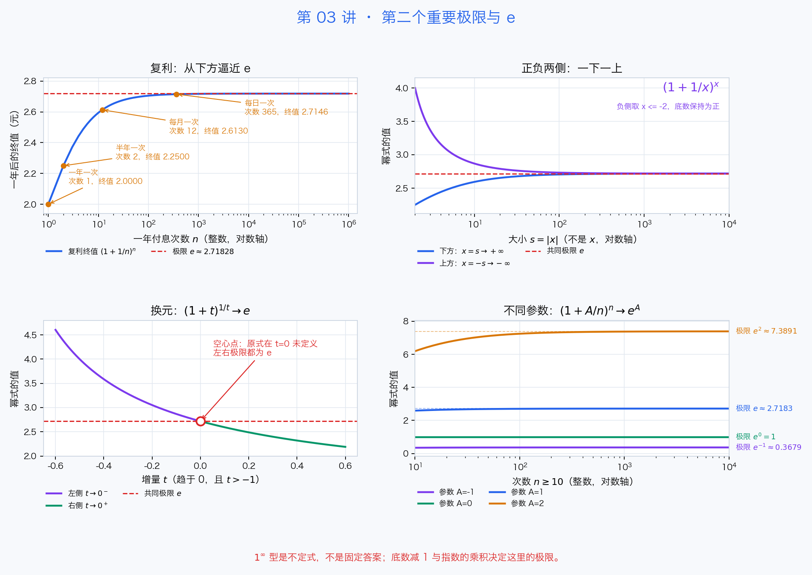

# 第 03 讲：第二个重要极限与 e——"无限频繁复利"算出来的无理数

> 学习时间：约 60 分钟。前置：第 01、02 讲。学完请做文末的练习，并运行 `tools/verify_e_limit.py`。

[学习首页](../README.md) · [上一讲：运算法则与无穷小](第02讲-极限的运算法则与无穷小的比较.md) · [下一讲：连续性与间断点](第04讲-连续性与间断点.md)

## 1. 先讲故事：1 元存一年，最多能变成多少？

假设银行年利率 100%（纯思想实验，别当真去存钱），本金 1 元，利息"利滚利"：

- 一年付一次利息： $1 \times (1+1) = 2$ 元
- 半年付一次（每次利率减半，滚 2 次）： $\left(1+\dfrac{1}{2}\right)^2 = 2.25$ 元
- 每季度付一次： $\left(1+\dfrac{1}{4}\right)^4 \approx 2.4414$ 元
- 每月付一次： $\left(1+\dfrac{1}{12}\right)^{12} \approx 2.6130$ 元
- 每天付一次： $\left(1+\dfrac{1}{365}\right)^{365} \approx 2.7146$ 元

付息越频繁，到手的钱越多——但**增长越来越慢**：从一年一次到半年一次涨了 0.25，从每月到每天才涨约 0.10。一个自然的猜想：这个数会逼近某个上限，而不是无限涨下去。

一年分 $n$ 期付息，终值是 $\left(1+\dfrac{1}{n}\right)^n$。 $n \to \infty$ 就是"连续复利"，而那个上限是：

$$\lim_{n \to \infty} \left(1+\frac{1}{n}\right)^n = e \approx 2.718281828459045\ldots$$

**这就是 $e$ 的出身**：它和 $\pi$ 一样，不是被人"定义"出来的，而是被一个逼近过程"逼"出来的。 $\pi$ 是圆的周长逼近出来的， $e$ 是复利逼近出来的。

程序员视角：这就像把循环的步长越切越细（dt 趋近于 0），模拟结果收敛到一个固定值——你在数值积分和物理引擎里天天干这件事。

## 2. 第二个重要极限：三种写法都认识一下

**数列版**（刚才的故事）：

$$\lim_{n \to \infty} \left(1+\frac{1}{n}\right)^n = e$$

**函数版**（ $x$ 取实数，正负两侧都行）：

$$\lim_{x \to \infty} \left(1+\frac{1}{x}\right)^x = e$$

注意 $x \to -\infty$ 时同样成立，很多人忽略了这一侧，配套脚本会演示两个方向同时逼近 $e$。

**等价形式**（做题时更常用）：令 $t = \dfrac{1}{x}$，则 $x \to \infty$ 对应 $t \to 0$：

$$\lim_{t \to 0} (1+t)^{\frac{1}{t}} = e$$

三种写法是同一个极限换了个"皮"。认出这个皮很重要：**底数趋向 1，指数趋向无穷大，且底数里那部分和指数互为倒数**——这就是它的特征长相。

## 3. 1^∞ 型：它是不定式，答案靠算不靠背

$1^{\infty}$ 型是**不定式**：底数往 1 压、指数往无穷抬，两股力量对抗，结果因题而异：

- $\lim\limits_{x \to \infty} \left(1+\dfrac{1}{x}\right)^x = e \approx 2.718$
- $\lim\limits_{x \to \infty} \left(1+\dfrac{2}{x}\right)^x = e^2 \approx 7.389$
- $\lim\limits_{x \to \infty} 1^x = 1$（底数恒等于 1，根本没动）

所以" $1^{\infty} = 1$ "是经典错误。遇到 $1^{\infty}$ 型，必须走下面的套路。

## 4. 解题套路：凑出标准形，再看"指数乘积"去哪

**核心套路**：遇到 $\lim\ u(x)^{v(x)}$，其中 $u \to 1$、 $v \to \infty$：

1. 把底数写成 $1 + \alpha$，其中 $\alpha \to 0$
2. 把指数拆成 $\dfrac{1}{\alpha} \cdot (\alpha v)$，凑出标准形 $\left(1+\alpha\right)^{\frac{1}{\alpha}}$
3. 标准形那部分趋向 $e$，剩下的 $\alpha v$ 单独求极限

一句话总结：**答案 $= e^{A}$，其中 $A = \lim\ (\alpha \cdot v)$**（底数减 1，再乘上原来的指数，取极限）。

**例 1**： $\lim\limits_{x \to \infty} \left(1+\dfrac{2}{x}\right)^x$。这里 $\alpha = \dfrac{2}{x}$， $\alpha v = \dfrac{2}{x} \cdot x = 2$，所以极限 $= e^2$。

**例 2**： $\lim\limits_{x \to \infty} \left(1-\dfrac{1}{x}\right)^x$。 $\alpha = -\dfrac{1}{x}$， $\alpha v = -1$，极限 $= e^{-1}$。

**例 3**（伪装型）： $\lim\limits_{x \to \infty} \left(\dfrac{x+1}{x-1}\right)^x$。先变形：

$$\frac{x+1}{x-1} = 1 + \frac{2}{x-1}$$

所以 $\alpha = \dfrac{2}{x-1}$， $\alpha v = \dfrac{2x}{x-1} \to 2$，极限 $= e^2$。

（严格地说，例 3 凑出的标准形是 $\left(1+\dfrac{2}{x-1}\right)^{\frac{x-1}{2}}$，剩余指数 $\dfrac{2x}{x-1} \to 2$ 用第 02 讲的极限运算法则单独算。套路的细节就是"凑倒数对，再算剩余指数"。）

## 5. 它和第 02 讲的等价无穷小什么关系？

第 02 讲的表里有两条： $\ln(1+x) \sim x$ 和 $e^x - 1 \sim x$（ $x \to 0$ ）。这两条正是第二个重要极限的推论：

- 由 $(1+x)^{\frac{1}{x}} \to e$ 两边取对数（对数连续时极限可以"穿"进去，第 04 讲会严格说），得 $\dfrac{\ln(1+x)}{x} \to 1$；
- 再令 $u = e^x - 1$ 做换元，得 $\dfrac{e^x - 1}{x} \to 1$。

所以两个重要极限不是孤立知识点：**第一个是三角函数求导的种子，第二个是指数/对数函数求导的种子**。等第 05 讲求出 $(e^x)' = e^x$ 这个"导数等于自己"的神性质，根就扎在今天这里。

### 用图串起来：同一个 e，三种逼近方式



左上按付息次数看复利；右上用 $|x|$ 对齐正、负两侧，一侧从下方、一侧从上方逼近 $e$。左下的空心点表示原式在 $t=0$ 未定义，但两侧极限相同。右下改变参数 $A$，极限就变成 $e^A$；底数趋于 1 不意味着答案只能是 1。

## 6. 严格证明长什么样？（见过即可）

教科书用**单调有界准则**证明：用二项式定理展开 $\left(1+\dfrac{1}{n}\right)^n$，可以证明它单调递增且永远小于 3，于是极限必然存在，命名为 $e$。思想类似"证明一个收敛迭代必有不动点"，现阶段知道思路即可，不用背过程。

## 7. 课后练习（先自己做，再对答案）

**练习 1**：求

$$\lim_{x \to \infty} \left(1+\frac{3}{x}\right)^x$$

**练习 2**：求

$$\lim_{x \to 0} (1-2x)^{\frac{1}{x}}$$

**练习 3**：求

$$\lim_{x \to \infty} \left(\frac{x}{x+1}\right)^x$$

**练习 4**（思考题）：第 1 节里，付息次数 $n$ 从 1 增加到 365，终值从 2 涨到 2.7146；为什么 $n \to \infty$ 时它不会"爆炸"成无穷大？试用"底数与指数的对抗"解释。

---

### 答案

1. $\alpha = \dfrac{3}{x}$， $\alpha v = 3$，极限 $= e^3 \approx$ **20.0855**。
2. $\alpha = -2x$， $\alpha v = -2x \cdot \dfrac{1}{x} = -2$，极限 $= e^{-2} \approx$ **0.1353**。
3. 变形 $\dfrac{x}{x+1} = 1 - \dfrac{1}{x+1}$， $\alpha = -\dfrac{1}{x+1}$， $\alpha v = -\dfrac{x}{x+1} \to -1$，极限 $= e^{-1} \approx$ **0.3679**。
4. 底数 $1+\dfrac{1}{n}$ 往 1 缩（压低结果），指数 $n$ 往无穷涨（抬高结果）， $1^{\infty}$ 型正是两者的拔河。二项式展开能看到每一项都被控制住、总和被压在 3 以下——所以它收敛到有限数 $e$，而不是爆炸。直觉类比：步长减半、步数加倍的数值模拟，总效果收敛而不是发散。

---

## 8. 动手环节

```bash
python3 tools/verify_e_limit.py    # Windows: python tools\verify_e_limit.py
```

脚本只用标准库，做四件事：

1. 把第 1 节的复利故事算给你看： $n$ 从 1 加到 3000 万， $\left(1+\dfrac{1}{n}\right)^n$ 如何一步步贴近 $e$（以及增速为什么越来越慢）
2. 两侧逼近： $x \to +\infty$ 和 $x \to -\infty$ 算出来都是 $e$
3. 等价形式： $x \to 0$ 时 $(1+x)^{1/x} \to e$
4. $1^{\infty}$ 型实战： $\left(1+\dfrac{2}{x}\right)^x \to e^2$、 $\left(1-\dfrac{1}{x}\right)^x \to \dfrac{1}{e}$

（彩蛋：脚本还会演示 $n$ 大到 $10^{15}$ 时，直接算 `(1+1/n)**n` 会翻车，而 `math.log1p` 的稳定写法安然无恙——第 02 讲的"灾难性抵消"又回来了。）

想调整付息次数、参数或重新生成配图，安装根目录 `requirements.txt` 后运行：

```bash
# macOS / Linux
python3 tools/visualize_e_limit.py
```

```powershell
# Windows
python tools\visualize_e_limit.py
```

图片保存到 `assets/images/lecture03/e_limit_plots.png`。只阅读无需安装依赖；无显示环境可设置 `MPLBACKEND=Agg`，仅保存不弹窗。

## 下一讲预告

第 04 讲：连续性与间断点——函数图像"一笔画"和"断开"的严格说法；以及闭区间上连续函数的两个神级定理：最值定理和零点定理（二分查找的数学执照）。配套视频：宋浩《高等数学》1.8–1.10 节。
