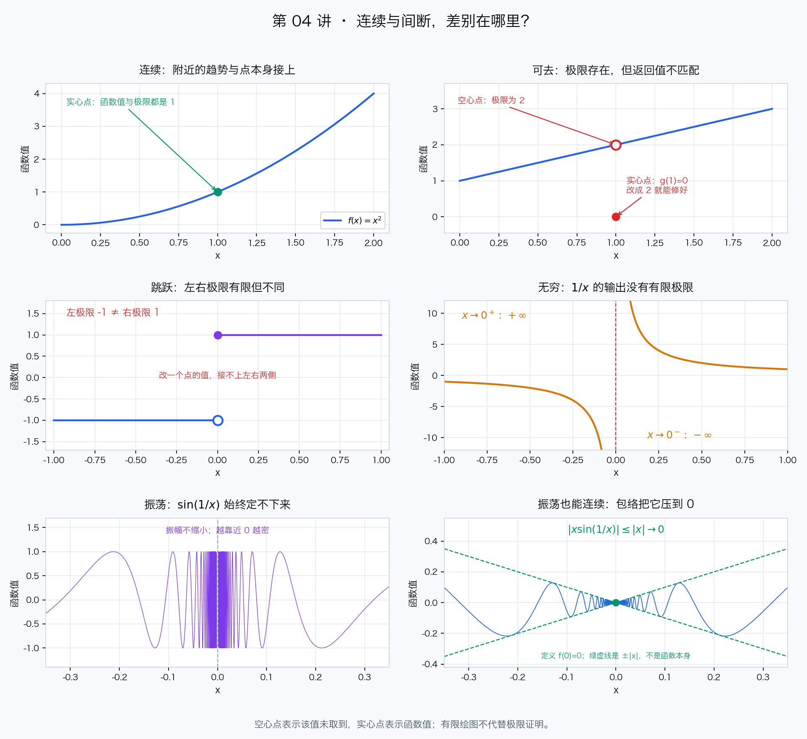
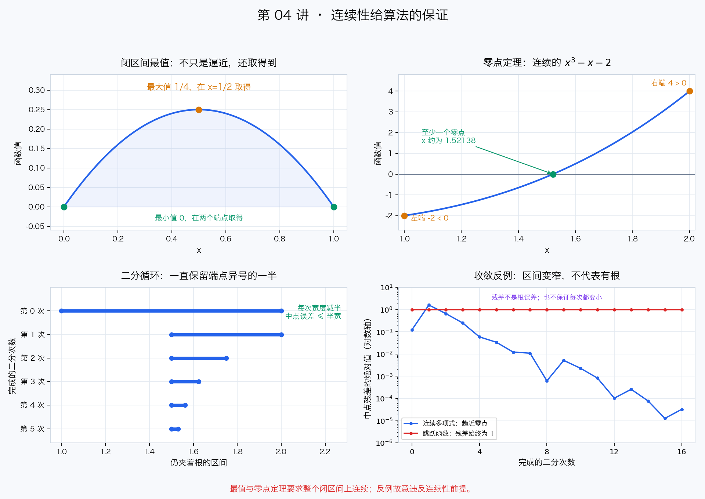

# 第 04 讲：连续性与间断点——二分查找的数学执照

> 学习时间：约 60–75 分钟。前置：第 01–03 讲。学完请做文末的练习，并运行 `tools/verify_continuity.py`。本讲学完，阶段一「函数与极限」的核心内容就串起来了。

[学习首页](../README.md) · [上一讲：第二个重要极限与 e](第03讲-第二个重要极限与e.md)

## 1. 先讲直觉：输入动一点，输出会不会突然跳？

想象两个程序：一个根据行驶时间计算路程，另一个判断订单是否达到包邮门槛。

- 路程函数：时间从 10 秒改成 10.001 秒，路程也只变一点点。
- 门槛判断：金额从 99.99 元改成 100 元，输出可能从“不包邮”突然变成“包邮”。

前者体现了**连续**的直觉，后者在门槛处发生了**跳跃**。

常听到“连续函数的图像可以一笔画下来”。这适合建立直觉，但不是严格定义：我们真正要表达的是，**在某个输入附近，只要把输入变化控制得足够小，就能把输出变化控制在任意指定的精度内**。

程序员视角：连续性像一种局部的“输入扰动可控，输出误差也可控”的保证。但它不保证输出变化与输入变化成正比，也不保证图像没有尖角——变化率要到下一讲的导数才讨论。

## 2. 连续的判定：三个检查缺一不可

对定义在某个内点附近的函数，**在点 $a$ 处连续**，就是：

$$\lim_{x \to a} f(x) = f(a)$$

把它拆成三个检查，做题时就不会漏条件：

1. **有返回值**： $f(a)$ 有定义。
2. **附近能收敛**： $\lim\limits_{x \to a} f(x)$ 存在，并且是有限数。
3. **两者对得上**：极限等于 $f(a)$。

第 01 讲强调：**极限只看点附近，不看点本身**。今天加上后半句：**连续性要把点附近的趋势和点本身的值对齐**。

### 例 1：没有特殊分支的连续函数

取 $f(x)=x^2$，在 $a=1$ 处：

$$\lim_{x \to 1} x^2 = 1 = f(1)$$

三个检查全过，所以连续。

### 例 2：极限存在，函数却不连续

$$g(x)=\begin{cases}
\dfrac{x^2-1}{x-1}, & x\ne 1 \\
0, & x=1
\end{cases}$$

当 $x\ne 1$ 时可以约分，得到 $g(x)=x+1$，所以：

$$\lim_{x \to 1} g(x)=2 \ne g(1)=0$$

极限存在，但“附近返回 2，恰好输入 1 却返回 0”，特殊分支与附近的趋势没接上，因此不连续。把 $g(1)$ 改成 2 就能修好。

### 左右极限与区间端点

在内点，两侧都要接得上：

$$\lim_{x \to a^-} f(x)=\lim_{x \to a^+} f(x)=f(a)$$

在闭区间 $[a,b]$ 上谈连续，端点只检查区间内的一侧：

- 左端点 $a$： $\lim\limits_{x \to a^+} f(x)=f(a)$。
- 右端点 $b$： $\lim\limits_{x \to b^-} f(x)=f(b)$。

这就像数组边界：不能要求函数去处理区间外根本不在定义域里的输入。

## 3. 为什么连续函数可以“直接代入”求极限？

因为连续的定义本来就是“极限等于函数值”。所以，**知道函数在目标点连续，就能直接代入**。

常见初等函数在各自的定义域内连续；它们的和、差、积以及合法的复合仍连续，商还要求分母在目标点不为 0。

- 多项式：处处连续，例如 $x^2+3x-2$。
- 有理函数：分母不为 0 的地方连续。
- $\sin x$、 $\cos x$、 $e^x$：在整个实数轴上连续。
- $\ln x$：在 $(0,+\infty)$ 内连续，不能把“直接代入”用到 $x=0$。

**复合函数的极限**也能用这条规则：若 $u(x)\to L$，外层函数 $F$ 在 $L$ 处连续，且复合式在目标点附近有定义，则：

$$\lim_{x \to a} F(u(x))=F(L)$$

程序员视角：内层调用逐渐稳定到 $L$，外层调用在 $L$ 处又不会跳变，于是最终输出稳定到 $F(L)$。

这就补上了第 03 讲“两边取对数”的前提：

$$\begin{aligned}
(1+x)^{1/x} &\to e \\
\ln\left((1+x)^{1/x}\right) &\to \ln e=1 \\
\frac{\ln(1+x)}{x} &\to 1
\end{aligned}$$

这里 $x\to 0$ 且 $x\ne 0$；在 0 附近底数 $1+x>0$，对数有定义，外层 $\ln$ 在正数 $e$ 处连续。所以极限才能“穿过”对数函数，不是任何函数都能这样操作。

## 4. 间断点：先看左右极限，再给问题分类

本节讨论函数在某点的两侧附近有定义，但该点本身没有定义或不连续的情况。你可以把间断点理解成需要排查的“连接故障”。

### 4.1 可去间断点：一个点没接对，补丁就能修好

特点：**左右极限都存在、有限且相等**，但是该点没有定义，或者函数值与极限不相等。

第 2 节的 $g$ 就是典型例子：在 $x=1$ 处，把函数值改成 2 就连续了。

另一个老朋友是 $\dfrac{\sin x}{x}$：在 $x=0$ 处原式没有定义，但极限是 1。补上这个值，得到连续延拓：

$$s(x)=\begin{cases}
\dfrac{\sin x}{x}, & x\ne 0 \\
1, & x=0
\end{cases}$$

程序员类比：一般分支正确，只有一个边界输入漏处理或返回错了值。**“可去”指的是故障能靠修改这个点的值去掉，不是把这个点从定义域删掉。**

### 4.2 跳跃间断点：左右接口对不上

$$j(x)=\begin{cases}
-1, & x<0 \\
1, & x\ge 0
\end{cases}$$

在 $x=0$ 处，左极限是 $-1$，右极限是 $1$，两者都有限，却不相等。

这时改 $j(0)$ 没用：你不可能让一个返回值同时等于 $-1$ 和 $1$。跳跃是附近两侧的行为造成的，不是单个点的值造成的。

### 4.3 无穷间断点：输出失控

取 $f(x)=\dfrac{1}{x}$，在 $x=0$ 附近：

$$\lim_{x \to 0^+}\frac{1}{x}=+\infty,\qquad
\lim_{x \to 0^-}\frac{1}{x}=-\infty$$

至少一侧不是有限极限。无论给 $f(0)$ 填什么有限值，都修不好。

### 4.4 振荡间断点：输出始终定不下来

取 $f(x)=\sin\dfrac{1}{x}$。它不会变得无穷大，但在 0 附近不停振荡。

与其随便抽几个输入，不如找两组都趋于 0 的输入：

$$x_n=\frac{1}{2\pi n+\pi/2},\qquad
y_n=\frac{1}{2\pi n+3\pi/2}$$

它们都从正侧趋于 0，却满足：

$$\sin\frac{1}{x_n}=1,\qquad \sin\frac{1}{y_n}=-1$$

沿两条逼近路径得到不同结果，所以连右极限都不存在。**有界不等于有极限，更不等于连续。**

### 分类速查

| 类型 | 左右极限的情况 | 只修改该点的值能修好吗？ |
|---|---|---|
| 可去 | 都存在、有限、相等，但该点未定义或值不匹配 | 能，填成共同的极限 |
| 跳跃 | 都存在、有限、不相等 | 不能 |
| 无穷 | 至少一侧趋于无穷 | 不能 |
| 振荡 | 至少一侧因振荡没有极限 | 不能 |

教材把**可去、跳跃**归为“第一类间断点”（左右极限都是有限数），其余归为“第二类间断点”。先会判别，再记名称。

### 用图排查：究竟是哪一种“没接上”？



按行对比：第一行区分连续与可去间断，第二行区分跳跃与无穷间断，第三行比较振荡本身和乘上 $x$ 后的结果。空心点表示该位置未取到，实心点才是函数值；右下绿虚线是 $\pm|x|$ 包络，不是函数本身。无限振荡不能画尽，是否存在极限仍要用正文的数列构造或夹逼来判断。

## 5. 闭区间上的连续函数：三个实用保证

下面三个定理都要求：**函数在整个闭区间 $[a,b]$ 上连续**。这是全局保证，不是只检查两个端点。

### 5.1 有界性与最值定理：不爆炸，而且最值取得到

如果 $f$ 在 $[a,b]$ 上连续，那么它有界，并且存在区间内的点，使函数真正取得最大值和最小值。

**“取得”比“逼近”更强**：不是只能越来越接近某个数，而是某个输入真的返回那个数。

例如 $f(x)=x(1-x)$ 在 $[0,1]$ 上连续，因为：

$$x(1-x)=\frac{1}{4}-\left(x-\frac{1}{2}\right)^2$$

所以最大值是 $\dfrac{1}{4}$，在 $x=\dfrac{1}{2}$ 取得；最小值是 0，在两个端点取得。

为什么条件不能乱删？

- **去掉闭区间条件**： $f(x)=x$ 在 $(0,1)$ 上连续且有界，却没有最大值、最小值；1 和 0 都只能逼近，取不到。 $\dfrac{1}{x}$ 在 $(0,1]$ 上连续，甚至不有界。
- **去掉连续条件**：在 $[0,1]$ 上令 $h(x)=x$（ $x<1$ ），而 $h(1)=0$。虽然定义在闭区间上且有界，仍没有最大值：所有输出都小于 1，任何候选最大值都能被更接近 1 的输入超过。

### 5.2 介值定理：从一个值走到另一个值，中间的值不会漏

如果 $f$ 在 $[a,b]$ 上连续，那么对于夹在 $f(a)$ 与 $f(b)$ 之间的任意数 $C$，区间内至少有一个点 $c$，使：

$$f(c)=C$$

直觉：连续的温度从 10 度变成 20 度，中间一定经历过 15 度。若允许瞬间跳变，这个保证就没了。

### 5.3 零点定理：端点异号，里面至少有一个根

零点定理是介值定理取 $C=0$ 的特殊情况：若 $f$ 在 $[a,b]$ 上连续，并且：

$$f(a)f(b)<0$$

那么在 $(a,b)$ 内至少存在一个 $c$，满足 $f(c)=0$。如果某个端点函数值已经为 0，那端点本身就是根，不必再用异号条件。

**注意两个“不保证”**：

- 不保证只有一个根。例如 $f(x)=x(x^2-1)$ 在 $[-2,2]$ 上连续、端点异号，却有 $-1,0,1$ 三个根。
- 不保证同号就没有根。例如 $f(x)=x^2$ 在 $[-1,1]$ 上端点同号，内部仍有根 0。端点异号是连续条件下的充分条件，不是必要条件。

## 6. 二分法：把零点定理写成一个循环

求方程 $x^3-x-2=0$ 在 $[1,2]$ 内的根。设 $f(x)=x^3-x-2$，它是连续的多项式，且 $f(1)=-2$、 $f(2)=4$，所以区间内一定有根。

二分法的操作和二分查找很像：

1. 取中点 $m=\dfrac{a+b}{2}$，计算 $f(m)$。
2. 如果 $f(m)=0$，找到根；否则保留端点异号的那一半。
3. 重复，直到区间足够窄。

关键循环不变量是：**当前区间两端异号，连续性保证区间内一直有根**。它不要求函数单调；不单调时可能有多个根，但仍能保留至少一个。

初始区间宽度是 $b-a$，若没有提前遇到精确零点，二分 $n$ 次后的宽度是：

$$\frac{b-a}{2^n}$$

把最终区间中点作为近似值，与区间内某个根的误差不超过半个区间宽度：

$$\frac{b-a}{2^{n+1}}$$

例如从 $[1,2]$ 开始二分 16 次，误差不超过 $\dfrac{1}{2^{17}}\approx 0.00000763$，根约为 1.52138。想让区间宽度不超过 $\varepsilon$，次数按 $\log_2\dfrac{b-a}{\varepsilon}$ 的量级增长。

### 反例：有异号，却没有连续性

把第 4 节的跳跃函数 $j$ 放到 $[-1,1]$ 上，端点值分别是 $-1$ 和 $1$，但它**只输出这两个数，永远不输出 0**。

如果机械地按符号二分，区间仍会越来越窄、越来越贴近跳点 0，却找不到任何零点。这就是“代码在收敛，但问题没有解”。

**区间缩小不等于找到根**。连续性不能靠一次符号检查证明；观察函数残差也很重要。配套脚本会让同一段二分代码分别处理连续多项式和跳跃函数，比较两种结果。

### 用图看保证：根被夹住，才谈得上误差



左上用实心点标出真正取得的最值，右上展示连续曲线在异号端点之间经过 0。左下每一行是一次二分后保留的区间；右下画的是**残差，不是根的误差**。连续多项式的残差总体趋于 0，但不保证每一步都变小；跳跃函数残差始终为 1，区间再窄也没有根。

## 7. 严格定义长什么样？（见过即可）

在定义域内， $f$ 在 $a$ 处连续的严格说法是：对任意 $\varepsilon>0$，都存在 $\delta>0$，使得对定义域中的所有 $x$：

$$|x-a|<\delta \quad\Longrightarrow\quad |f(x)-f(a)|<\varepsilon$$

- $\varepsilon$：你指定的输出误差上限。
- $\delta$：为了满足这个上限，需要控制的输入范围。
- “所有 $x$”：不是恰好抽样到几个好看的输入，而是范围内每个合法输入都满足。

和第 01 讲的极限定义相比，这里比较的是 $f(a)$，而且允许 $x=a$——函数在这个点必须有值，附近还要接上它。

最后记住：**连续不等于可导**。例如 $f(x)=|x|$ 在 0 处连续，但图像有尖角，左右斜率不同。下一讲就会用“差商的极限”精确描述这件事。

## 8. 课后练习（先自己做，再对答案）

**练习 1：给边界输入补上正确返回值。** 令：

$$f(x)=\begin{cases}
\dfrac{\sin x}{x}, & x\ne 0 \\
c, & x=0
\end{cases}$$

常数 $c$ 取多少时，函数在 0 处连续？如果 $c=2$，0 是哪类间断点？

**练习 2：把两个分支接起来。** 令：

$$f(x)=\begin{cases}
x^2, & x<1 \\
kx+1, & x\ge 1
\end{cases}$$

求使函数在 $x=1$ 处连续的 $k$。

**练习 3：分类排查。** 判断以下函数在 0 处连续，还是有间断点；若有间断点，说明类型。

1. $f(x)=\dfrac{1}{x}$，在 0 处没有定义。
2. $f(x)=\sin\dfrac{1}{x}$（ $x\ne 0$ ），且 $f(0)=0$。
3. $f(x)=x\sin\dfrac{1}{x}$（ $x\ne 0$ ），且 $f(0)=0$。
4. $f(x)=-1$（ $x<0$ ）， $f(x)=1$（ $x\ge 0$ ）。

**练习 4：最值到底取不取得到？** 求 $f(x)=x(1-x)$ 在 $[0,1]$ 上的最大值和最小值，并写出取得它们的点。如果把区间换成 $(0,1)$，最大值、最小值还存在吗？

**练习 5：给二分法检查前置条件。** 证明方程 $\cos x=x$ 在 $(0,1)$ 内至少有一个解。该用哪个函数进行二分？只看端点异号，能推出解唯一吗？三角函数的输入按弧度计算。

**练习 6：误差预算。** 从 $[1,2]$ 开始，每次保留端点异号的一半，完成 10 次二分且未提前找到精确零点。最终区间有多宽？用最终区间中点作近似值，误差上界是多少？这两个数字能否直接用于不连续的跳跃函数，保证“找到一个根”？

---

### 答案

1. 第一个重要极限给出 $\lim\limits_{x\to 0}\dfrac{\sin x}{x}=1$，所以需要 $c=1$。若 $c=2$，极限仍为 1，但函数值是 2，因此是**可去间断点**；改成 1 即可修复。
2. 左极限为 1，右极限与函数值都是 $k+1$。要求 $1=k+1$，得 $k=0$。两个分支各自在自己的区间内连续，这样接好后整个函数也连续。
3. 依次为：**无穷间断点、振荡间断点、连续、跳跃间断点**。第三个容易误判：虽然 $\sin\dfrac{1}{x}$ 不收敛，但 $\left|x\sin\dfrac{1}{x}\right|\le |x|\to 0$，由第 02 讲“有界量 × 无穷小”可得极限为 0，正好等于 $f(0)$。是否连续，要检查整个函数，而不是只看某个因子。
4. 用 $x(1-x)=\dfrac{1}{4}-\left(x-\dfrac{1}{2}\right)^2$，最大值为 $\dfrac{1}{4}$，在 $x=\dfrac{1}{2}$ 取得；在 $[0,1]$ 上有 $x(1-x)\ge 0$，最小值为 **0**，在 $x=0,1$ 取得。换成 $(0,1)$ 后，最大值仍取得到，因为中点还在；**最小值不存在**，因为每个输出都大于 0，却能无限逼近 0。开区间不是必然没有最值，而是没有闭区间连续函数的统一保证。
5. 令 $F(x)=\cos x-x$。它在 $[0,1]$ 上连续， $F(0)=1>0$， $F(1)=\cos 1-1<0$，由**零点定理**，在 $(0,1)$ 内至少有一个解。用这个 $F$ 二分即可，近似解约为 0.739085。**仅凭连续和端点异号不能推出唯一性**；本题实际唯一，可以另外观察 $\cos x$ 在 $[0,1]$ 上严格递减，而 $x$ 严格递增，因而 $\cos x-x$ 严格递减。
6. 最终宽度为 $\dfrac{1}{2^{10}}=0.0009765625$；中点到区间内某个根的误差不超过 $\dfrac{1}{2^{11}}=0.00048828125$。这依赖函数连续、根始终被夹在区间内。对跳跃函数，区间可能照样变窄，但根根本不存在，不能把半宽解释成根的误差上界。

---

## 9. 动手环节

从仓库根目录运行（无需安装依赖）：

```bash
# macOS / Linux
python3 tools/verify_continuity.py
```

```powershell
# Windows（PowerShell 或 CMD）
python tools\verify_continuity.py
```

脚本只用 Python 标准库，输出五组对照：

1. **点附近与点本身**：看 $x^2$ 在 1 附近连续；再看极限为 2、函数值却为 0 的可去间断点，最后把函数值补成 2。
2. **三种修不好的间断**：比较跳跃、无穷与振荡。振荡例子按第 4 节的两组输入构造，不靠随意抽样猜结论。
3. **极限穿过连续的对数**：看 $(1+x)^{1/x}$ 趋近 $e$ 时，它的对数如何趋近 1，呼应第 03 讲。
4. **闭区间最值**：用不同网格采样 $x(1-x)$，与手算得到的最值对照；再看开区间中的输入如何趋近 1 却永远不是 1。
5. **同一段二分代码的两种命运**：连续多项式逼近零点，跳跃函数只逼近跳点，残差的绝对值始终为 1。

运行后，试着自己改代码：把二分对象换成练习 5 的 $\cos x-x$，初始区间换成 $[0,1]$，看结果是否贴近 0.739085。

> 数值计算用于观察和核对，不代替证明。有限次采样不能证明函数连续或不存在间断点，网格上的最大值也不一定是真正的最大值。定理的条件要靠数学检查，代码负责把结论演示出来。

想重新生成本讲两张配图，安装根目录 `requirements.txt` 后运行：

```bash
# macOS / Linux
python3 tools/visualize_continuity.py
```

```powershell
# Windows
python tools\visualize_continuity.py
```

图片保存到 `assets/images/lecture04/`；只阅读笔记无需安装依赖。无显示环境可设置 `MPLBACKEND=Agg`，仅保存不弹窗。

## 下一讲预告

第 05 讲：导数的定义与几何意义——从平均变化率到瞬时变化率，从割线到切线；再推导几个基本求导公式。为什么 $|x|$ 连续却在 0 处没有导数？为什么 $e^x$ 的导数还是它自己？可以提前看看 `tools/animate_calculus.py` 生成的割线变切线动画。
